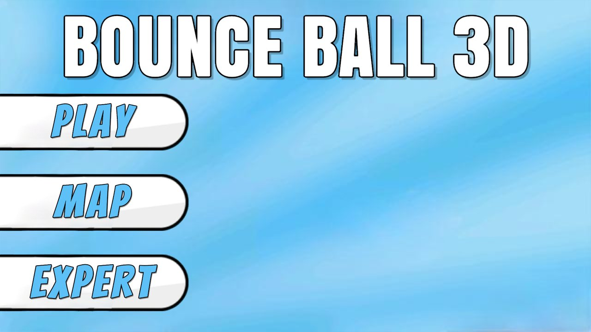
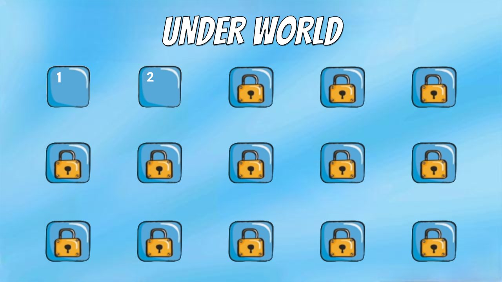
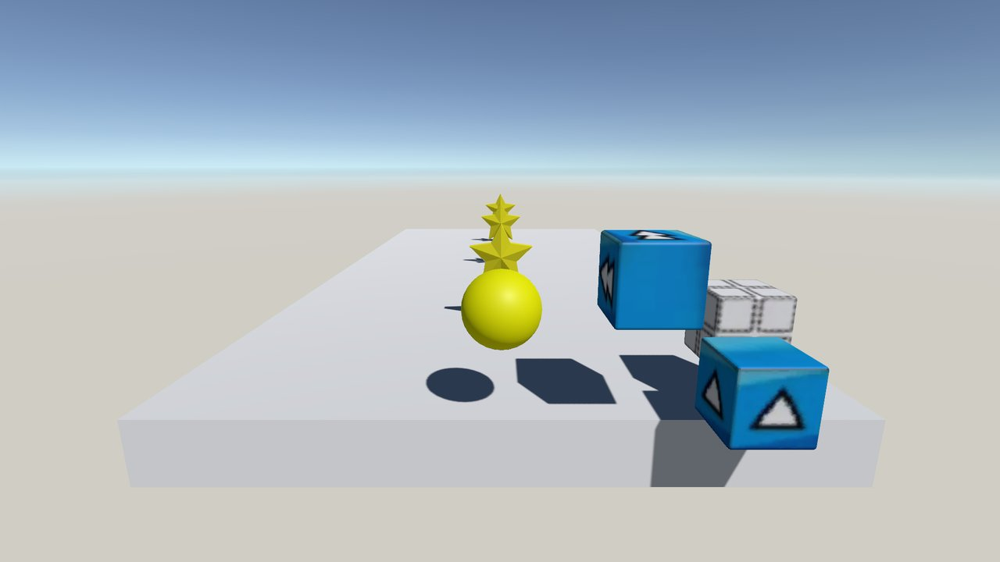
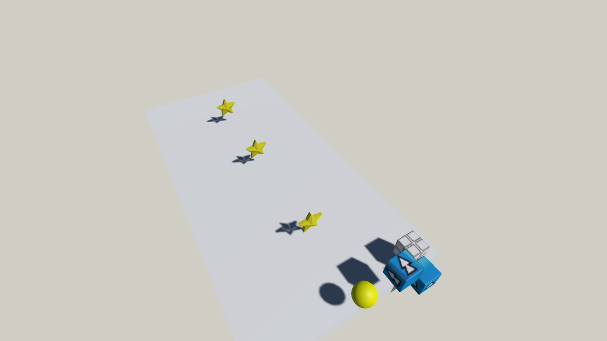

# Bounce Ball 3D

A Unity game that reimagines the classic game **Bounce Ball** in 3D.
IPSE 2023 Unity Seminar Project (Nov 2023)

<p align="center">
  
</p>

## Overview

A 3D puzzle action game where you control a ball that bounces automatically every time it touches the ground, and **clear a stage by collecting all of its stars**.
The rules of the 2D classic Bounce Ball are brought into 3D space, so players rotate the camera to find their way through each stage.
The block 3D models were made in Blender.

## Features

| Category | Description |
| --- | --- |
| **Auto bounce** | Physics-based movement that always bounces to the same height when touching the ground or a block |
| **Special blocks** | Jump block (double jump), block that disappears after one touch, flight block (flies in a straight line) |
| **Stage progression** | Collect all stars to move to the next stage; falling restarts the current stage |
| **Stage unlocking** | 15-slot stage select screen; clear records are saved (PlayerPrefs) to unlock the next stage |
| **Third-person camera** | Rotate freely around the ball with the mouse; WASD movement relative to the camera direction |
| **Pause** | Q to pause / R to resume, Home and Retry buttons |
| **Sound** | Singleton AudioManager keeps sound effects alive across scene changes |

## Screenshots

| Stage Select | Gameplay |
| :---: | :---: |
|  |  |

<p align="center"><br><sub>Full stage overview</sub></p>

## Controls

| Key | Action |
| --- | --- |
| W A S D | Move (relative to camera direction) |
| Mouse | Rotate view |
| Direction input (while flying) | Stop flying |
| Q / R | Pause / Resume |

## Tech Stack & Structure

| Category | Technology |
| --- | --- |
| Engine | Unity 2021.3.14f1 (3D Physics, TextMeshPro, uGUI) |
| Language | C# |
| 3D Modeling | Blender (jump, flight, and one-touch blocks, grass block) |

```
IPSE 3D Bounce Ball/Assets/Scripts
├── Ball.cs            # Movement, auto bounce, special block effects, flight, star collection
├── GameManager.cs     # Stage clear check, progress saving, stage transition/restart
├── UIManager.cs       # Locked/unlocked display on the stage select screen
├── PauseUIManager.cs  # Pause / Home / Retry
├── CameraMove.cs      # Mouse-driven third-person orbit camera
├── AudioManager.cs    # Sound effect singleton
└── ObjectBounce.cs    # Star rotation and floating animation
```

### Folder Layout

| Folder | Contents |
| --- | --- |
| `IPSE 3D Bounce Ball/` | **Main Unity project** |
| `3D Model/` | Original block models (.blend / .fbx) |
| `Image/`, `Sound/` | Original UI images and sound effects |
| `My project/` | Early prototype (ball movement and camera) |
| `IPSE_Semina/` | Seminar practice project |

## How to Run

1. Download the Windows build from [Releases](../../releases) and run `Bounce.exe`
2. Or open the `IPSE 3D Bounce Ball/` folder in Unity Hub with **Unity 2021.3.14f1** and run `Assets/Scenes/MainMenuUI.unity`
